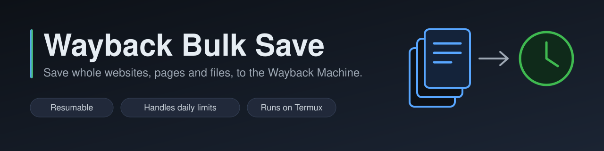
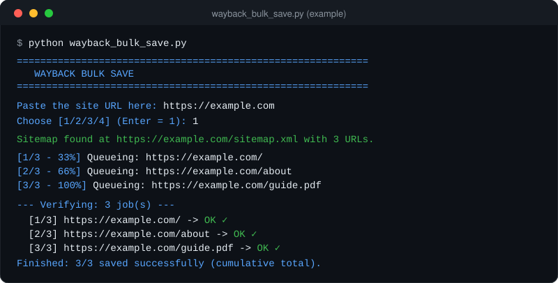

<p align="center">
  
</p>

<p align="center">
  <a href="LICENSE"></a>
  
  
  <a href="docs/GUIDE.md"></a>
</p>

Save an entire website (pages **and** downloadable files) to the
[Internet Archive's Wayback Machine](https://web.archive.org) using Save Page Now.

Give it a site URL. It finds the pages (sitemap, crawl, a URL list, or a
[Firecrawl](https://www.firecrawl.dev) map), queues them all, confirms every capture,
and keeps going across days if the Archive's daily limits stop it.

<p align="center">
  
  <br>
  <sub>Example output (illustrative).</sub>
</p>

## Features

- **4 discovery modes:** sitemap, forced crawl, single URL / pasted URL list, import from a file (CSV/TXT/Firecrawl export).
- **Files, not just pages:** PDFs, documents, installers (`.exe`, `.msi`, `.dmg`, `.apk`, ...), archives, `mp3`/`mp4`, even when they are hosted on another domain. Replaced files at the same URL are re-saved after N days.
- **Size cap** for files (default 200 MB); skipped files are listed in `skipped_too_big_<site>.json`.
- **Pages first, heavy files last,** so the daily bandwidth limit never blocks the site's pages.
- **Resumable:** progress is stored per site; re-run the script and it continues where it stopped.
- **Stops cleanly on the Archive's daily bandwidth limit** and resumes the next day.
- **One folder per site** next to the script, with every state file inside.
- **Start/end log per site** (`timeline_<site>.txt`) so you can see how long a full archive took.
- Works on Windows, Linux, macOS and Termux (Android).

**New here? Read the [Guide](docs/GUIDE.md) first:** how it works, what it can and
cannot do, and why Firecrawl is used.

## Requirements

- Python 3.9+
- `pip install -r requirements.txt`
- Free Internet Archive S3-style keys: <https://archive.org/account/s3.php>
- Optional: a [Firecrawl](https://www.firecrawl.dev) API key (only for the Firecrawl discovery mode)
- On Android? See [Running it on a phone (Termux)](docs/GUIDE.md#3-running-it-on-a-phone-termux-android).
  Full requirements: [Guide, section 2](docs/GUIDE.md#2-what-you-need-before-running-it).

## Setup

```bash
git clone https://github.com/AccelArch/wayback-bulk-save.git
cd wayback-bulk-save
pip install -r requirements.txt
cp config.example.json config.json   # then fill in your keys (that is the only place they go)
```

`config.json` is ignored by Git, so `git pull` updates the script without touching your keys. **If you fork this project or share your own copy, never include `config.json` or your keys.**

## Usage

```bash
python wayback_bulk_save.py
```

The script asks for the site URL and the discovery mode, then does the rest.
Restrict a crawl to a section by giving a URL with a path (for example
`https://example.com/docs`); only pages under that path are followed.

Per-site files are written to `<site_slug>/`:

| File | Purpose |
|---|---|
| `saved_urls_<slug>.json` | log of every URL and its capture result |
| `pending_jobs_<slug>.json` | jobs accepted by the Archive but not yet confirmed (resume) |
| `url_list_<slug>.json` / `crawl_state_<slug>.json` | discovered URLs / crawl progress |
| `skipped_too_big_<slug>.json` | files above the size cap |
| `timeline_<slug>.txt` | human-readable start/end time of each run |

## Keep a record of what you archived

The per-site progress files are git-ignored. To publish a clean record of a finished
archive instead, run:

```bash
python record_archive.py <site_folder>
```

It writes `archived-sites/<site>/` with the list of every URL saved
(`saved-urls.txt`), the capture dates, and a summary `README.md`, and refreshes the
index in [`archived-sites/`](archived-sites/). Run it again after a resumed run to
update the record.

## Removal requests

If you own a site, or your personal information appears in something archived
through this project, **you can ask for it to be removed and the maintainer will
honor it.** Open a [Removal request](../../issues/new?template=removal-request.yml)
issue. The URLs and details are removed from this repository (for personal data,
from its history too). Snapshots already on web.archive.org belong to the Internet
Archive and must be removed through them; the maintainer will not object.

## Rules of use

- Respect the Archive's limits. The script waits between requests and stops on the daily bandwidth limit; don't lower the delay to hammer the service.
- Only archive public content. Don't use it to bulk-fetch sites you aren't allowed to copy or to overload someone else's server.
- You are responsible for what you archive under your own keys.
- Not affiliated with the Internet Archive or Firecrawl. Provided "as is", no warranty.

Full rules and disclaimer: [Guide, section 12](docs/GUIDE.md#12-rules-of-use-please-read).

## Request an archive

Want a site preserved but don't want to run this yourself? Open an issue with the
**Request a site archive** form. Requests are reviewed manually and may be declined
(size, legality, or the daily quota).

## Credits

If you share, fork or build on this project, please **keep the copyright notice**
(the [MIT license](LICENSE) requires it) and, if you can, **link back to this
repository** so others can find the original. If you write about it or use it for a
project you publish, a mention is appreciated. Using the tool to archive sites needs
no credit.

## License

MIT, see [LICENSE](LICENSE).
