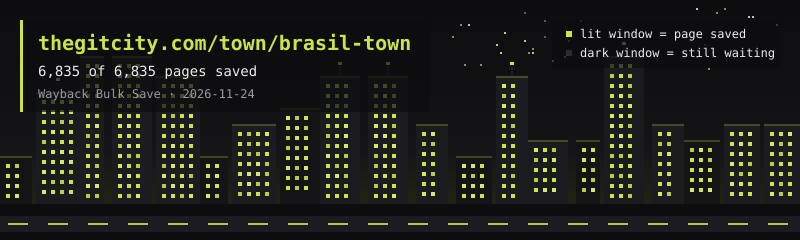

# https://thegitcity.com/town/brasil-town

| | |
|---|---|
| **Site** | https://thegitcity.com/town/brasil-town |
| **URLs saved** | 6798 of 6798 |
| **First capture** | 2026-11-10 13:48 UTC |
| **Last capture** | 2026-11-16 23:07 UTC |
| **Archiving started** | 2026-11-10 13:24 UTC |
| **Archiving finished** | 2026-11-16 23:07 UTC |
| **Total time** | 6d 9h 42min |
| **Record last updated** | 2026-11-16 23:16 UTC |

View the snapshots: <https://web.archive.org/web/*/https://thegitcity.com/town/brasil-town/*>

Files in this folder:

- [`saved-urls.txt`](saved-urls.txt): every URL confirmed saved, one per line
- [`info.json`](info.json): the same facts in machine-readable form
- [`method.md`](method.md): how the list of URLs was obtained
